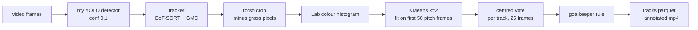
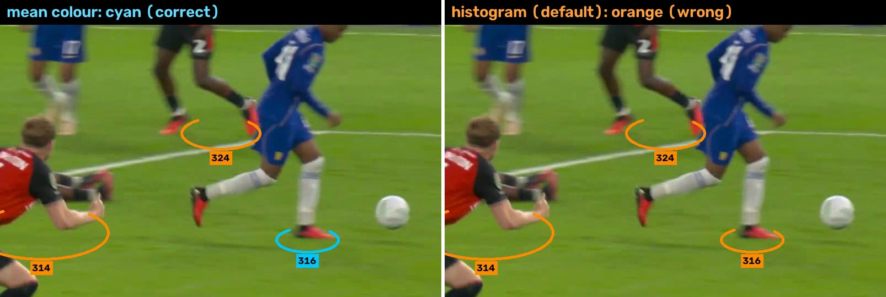

<p align="center">
  
</p>

A computer-vision pipeline that follows every player in a football broadcast with a fixed ID and splits them into
the two teams by shirt colour, with seven trackers benchmarked on SoccerNet-Tracking.

<p align="center">
  <a href="https://youtu.be/YrP9KGjes4g">
    
  </a>
  <br>
  <sub><b>▶ Click for the full 2-minute demo on YouTube</b> (unlisted). Five seconds of a broadcast highlights clip run
  through <code>scripts/process_video.py</code> with my first detector (v3): orange and cyan are the two teams, white is "no team" (keepers, referees).
  Footage © its rights holder, shown as a non-commercial portfolio demo.<br>
  The numbers drawn on players are <b>tracker IDs, not jersey numbers</b>: the tracker numbers each new track it starts
  (so #122 is simply the 122nd track), and reading shirt numbers is a separate, later task.</sub>
</p>

<p align="center"><b>Try it live:</b> <a href="https://huggingface.co/spaces/Kushagra77/football-detect-serve">Hugging Face Space</a> (upload a short football clip on the <i>Track (video)</i> tab; runs on a free ZeroGPU, so a visitor gets a few minutes of GPU per day, and only the first 20 s of a clip are used).</p>

| Headline result (SoccerNet-Tracking test split, 49 clips, best tracker BoT-SORT + GMC, my detector v6) | |
|---|---|
| Tracking score (HOTA) with a perfect detector (**oracle**) | **84.2** |
| Tracking score (HOTA) with my own detector (**real**) | **63.6** (59.0 with my first detector, v3) |
| Players given the correct team (tracked + voted, per detection; 98.5% without the vote, see below) | **99.0%** |
| Speed: detector + tracker + camera-motion compensation + colour features, 1080p, no rendering, MacBook Pro (Apple M2, 8 GB, PyTorch MPS) | **~35-45 fps** with v3 at 640 px (v6 reads 1280 px frames, so it is slower on a laptop; not re-timed there) |

## What this project does

Give it a football broadcast video. It finds every player, follows each one with a fixed ID number as they move,
and splits them into the two teams by shirt colour. The output is an annotated video and a table (one row per player
per frame) that later projects can use for tactics.

It also answers a measurement question: **how much tracking quality is lost because the detector is imperfect?**
Every tracker is run twice, once on the true player boxes (oracle) and once on my detector's boxes (real), and the
difference is the detector's cost.

<p align="center">
  
  <br>
  <sub>Two seconds of the demo, drawn from the pipeline's output table only (feet positions, no video pixels):
  orange and cyan are the two teams, white is "no team", numbers are tracker IDs (not jersey numbers).</sub>
</p>

## How to read the numbers

| Term | Meaning |
|---|---|
| Oracle | The tracker gets the true player boxes (a perfect detector): the best it could possibly do. |
| Real | The tracker gets my own detector's boxes: what you get in practice. |
| HOTA (0-100) | The main tracking score: finds the players **and** keeps the same ID on each one. |
| DetA | Detection part of HOTA: were the players found? |
| AssA | Association part of HOTA: did each player keep his ID over time? |
| IDF1 | Identity F1 score over the whole sequence: balances identity precision and recall, so it measures how well detections carry the correct ground-truth identity. Higher is better. |
| IDSW | ID switches: times a player's number jumped to someone else. Lower is better. |
| Detector cost | Oracle HOTA minus Real HOTA: how much the imperfect detector loses. |

## How it works



1. **Detect.** My YOLO detector ([football-detect-serve](https://github.com/Kushagra077/football-detect-serve); v6 is the default, v3 was the first model, see [Detector comparison](#detector-comparison-v3-v6-v7-v8)) finds players, goalkeepers and referees. Confidence is kept low (0.1) so the
   tracker's second pass can use weak boxes.
2. **Track.** Ultralytics' tracker classes give each box an id. Evaluation feeds cached boxes to the tracker; uploaded
   video goes through `model.track(stream=True)`, and both give identical output on one val clip's frames.
3. **Colour.** For each player box: take the torso band (15-50% of the height, 20% trimmed off each side), drop grass
   pixels (HSV hue 34-42), and describe what is left as a colour histogram in Lab space (4 x 6 x 6 bins; distances in Lab
   match how different colours look). A histogram keeps both stripes of a striped shirt, where a mean would blend them into
   a colour neither stripe has. The mean Lab colour is still computed, for the referee rule in step 4.
4. **Cluster.** KMeans with k=2 on the players of the first 50 frames that show at least 3 players. No labels needed.
   On uploaded video, only wide pitch-view frames are used and labelled (close-ups get no team), and a box whose mean
   colour fits neither team (a black-kit referee) gets no team.
5. **Vote.** Each track's label is the majority of its labels 12 frames back and 12 frames forward (the pipeline reads the
   whole video first, so it can look both ways). There is no permanent lock: trackers sometimes move an id onto another
   player, and a lock would keep the wrong team for the rest of the clip (lock cost 6-8 accuracy points).
6. **Goalkeepers.** A keeper's colour matches neither team, so a keeper joins the team whose players stand nearer in the
   image (median x). If the teams overlap or the keeper is in between, the answer is "unknown" (null), not a guess.
7. **Export.** `tracks.parquet` (see [Output format](#output-format)) plus an annotated mp4.

## Results

### Trackers (SoccerNet-Tracking test split, 49 clips, run once)

Detector: **v6** (the best of my four detectors on val, see [Detector comparison](#detector-comparison-v3-v6-v7-v8)); the last column shows the same tracker with my first detector, v3. Settings were chosen on the 11 validation clips only; the test split was run once per detector with them fixed.

**How it was scored.** Metrics come from [TrackEval](https://github.com/JonathonLuiten/TrackEval)'s HOTA, CLEAR and
Identity classes, called through my own thin wrapper (`src/ftt/eval/trackeval_wrap.py`), so the numbers are not
directly comparable to the SoccerNet leaderboard. Players, goalkeepers and referees are scored together as persons
(class labels are ignored; the ball and "other" are excluded). **No leakage:** the detector was never trained on
any validation or test clip (checked by `scripts/prepare_data.py`). The detector's training did use the validation clips to pick a
checkpoint, so validation numbers may be slightly optimistic; the numbers below are from the test split.

<p align="center">
  
</p>

| Tracker | Oracle HOTA | Oracle DetA / AssA | Real HOTA | Real DetA | Real AssA | Real IDF1 | ID switches (oracle / real) | Detector cost | Real HOTA with v3 |
|---|---|---|---|---|---|---|---|---|---|
| **BoT-SORT + GMC** | **84.2** | 95.4 / 74.4 | **63.6** | **74.1** | **54.7** | **73.3** | 1251 / 1849 | 20.6 | 59.0 |
| Deep OC-SORT + GMC | 76.6 | 87.1 / 67.3 | 61.0 | 71.9 | 51.9 | 71.3 | 1544 / 2350 | 15.6 | 56.0 |
| BoT-SORT (no GMC) | 80.4 | 93.2 / 69.5 | 60.6 | 72.8 | 50.5 | 69.2 | 3524 / 2511 | 19.9 | 56.6 |
| OC-SORT | 75.2 | 86.1 / 65.8 | 59.3 | 70.8 | 49.8 | 69.6 | 3062 / 2770 | 15.9 | 55.2 |
| FastTracker | 74.1 | 86.0 / 64.0 | 59.2 | 71.2 | 49.3 | 68.8 | 3687 / 2395 | 15.0 | 55.0 |
| ByteTrack | 74.1 | 86.0 / 64.0 | 59.1 | 71.0 | 49.4 | 69.0 | 3650 / 2485 | 15.0 | 55.3 |
| OC-SORT (+ BYTE low-conf pass) | 75.2 | 86.1 / 65.8 | 59.1 | 70.8 | 49.5 | 69.4 | 3062 / 2693 | 16.1 | 55.4 |

- **The detector costs about 15-21 HOTA points** (19-25 with v3), e.g. BoT-SORT+GMC 84.2 -> 63.6 and ByteTrack 74.1 -> 59.1.
  The split is approximate, not additive: a missed box hurts differently depending on the tracker's settings.
- **Detection and association both drop by about 15-21 points** (e.g. BoT-SORT+GMC DetA 95.4 -> 74.1, AssA 74.4 -> 54.7).
  Association still ends up the weaker of the two (49-55 vs 71-74).
- **Camera-motion compensation (GMC) matters for broadcast video.** It is BoT-SORT+GMC's edge: on oracle boxes it cuts
  ID switches from 3524 to 1251, and on my detector's boxes it adds 3.0 HOTA (60.6 -> 63.6; 2.4 with v3).
- **The bottom four trackers (59.1-59.3 real HOTA) are within 0.2 HOTA** and swap places between val and test, so treat them as equal.
- Tuning (one shared setting for all trackers, stored once in `configs/tuned.yaml`: `track_high_thresh 0.25`, `match_thresh 0.9`) gained +1.1..+3.5 HOTA on
  val and +0.3..+2.7 on test, measured with v3's boxes (val log: `results/tuning_val.jsonl`). A check on v6 chose the same knobs, so the setting was kept.
- **Tuning has a cost: more ID switches** (measured with v3's boxes). On test the shared setting raises ID switches for 6 of 7 trackers (e.g.
  BoT-SORT+GMC 2398 -> 2705, OC-SORT 3525 -> 3805; FastTracker is the exception, 3368 -> 3271). It lowers the first-pass
  confidence from 0.5 to 0.25, so weaker boxes are tracked: DetA and HOTA go up, switches too.
- **The detector is the bottleneck, not the association step** (measured with v3's boxes). On val the detector alone reaches DetA 68.3 / 72.8 / 73.1
  at confidence 0.1 / 0.25 / 0.5 (no tracker), and BoT-SORT+GMC's tracked DetA is 74.2 (untuned): the tracker finds about
  as many players as the detector does.

**Does appearance ReID help?** I expected little help, since ten teammates in identical kits look alike. To test it, I added
Ultralytics' trained ReID model (`yolo26n-reid.onnx`) to BoT-SORT + GMC and changed nothing else (`configs/botsort_gmc_reid.yaml`,
the same shared tuned setting; the ReID thresholds are the defaults, not tuned). This test used my first detector, v3, and was not re-run with v6. Test split, run once:

| (detector v3) | Oracle HOTA | Oracle ID switches | Real HOTA | Real AssA | Real ID switches |
|---|---|---|---|---|---|
| BoT-SORT + GMC | **84.2** | **1251** | **59.0** | **49.4** | **2705** |
| + appearance ReID | 82.9 | 1355 | 58.2 | 48.3 | 3603 |

- **ReID does not help, and slightly hurts**: -1.3 HOTA on true boxes and -0.8 on my detector's, with more ID switches
  (+104 and +898). On val the two are tied (oracle 85.9 vs 86.0, real 63.2 vs 63.3).
- This is one ReID model with untuned thresholds, so it shows ReID is not a free win here, not that no ReID could help.
  Why it fails is my expectation (identical kits), not something I measured.

### Detector comparison (v3, v6, v7, v8)

The study first used v3 (the nano model, 640 px). I then trained three more detectors in [football-detect-serve](https://github.com/Kushagra077/football-detect-serve).
Each runs at the input size it was trained at (v3 640 px, v7 and v8 960 px, v6 1280 px). The size is read from the weights
(`detector_imgsz` in `src/ftt/detect/run_detector.py`), so a new model needs no code change, and `FTT_DETECTOR=<name>` runs any
script with another model. Boxes and results are stored per detector, so v3's results were not overwritten.
The tables in this README use v6; the v3 numbers stay in the last column of the tracker table and in `results/`.

BoT-SORT + GMC with the same shared tuned setting for every detector (`scripts/compare_detectors.py`, file `results/detector_comparison.json`):

| Detector | Split | HOTA | DetA | AssA | IDF1 | ID switches | Team accuracy (centred vote) |
|---|---|---|---|---|---|---|---|
| v3 | val | 63.3 | 74.5 | 53.9 | 74.4 | 414 | 99.0% |
| v8 | val | 64.9 | 75.5 | 55.9 | 76.2 | 388 | 99.1% |
| v7 | val | 64.9 | 75.3 | 56.1 | 76.2 | 363 | 99.2% |
| **v6** | val | **66.0** | **76.5** | **57.0** | **77.0** | **299** | 99.1% |
| v3 | test | 59.0 | 70.9 | 49.4 | 68.5 | 2705 | 98.9% |
| v8 | test | 61.3 | 72.7 | 51.8 | 70.4 | 2407 | 98.9% |
| v7 | test | 62.5 | 73.5 | 53.3 | 72.2 | 2039 | 98.9% |
| **v6** | test | **63.6** | **74.1** | **54.7** | **73.3** | **1849** | **99.0%** |

- **How v6 was chosen:** on val it was best on every tracking column. The test split was then run once for v6 (the study's rule:
  choose on val, run test once). v7 and v8 were run on test afterwards, for information; they did not change the choice.
- **Result on test:** v6 gains +4.6 HOTA over v3 (59.0 -> 63.6) and has 32% fewer ID switches. The gap to the true-box ceiling
  (84.2) shrinks from 25.2 to 20.6 points, so the detector is still the bottleneck, just a smaller one.
- **The order on test is v3 < v8 < v7 < v6.** v7 and v8 tie on val (64.9) and separate on test (62.5 vs 61.3), as in the
  detector's own mAP (test mAP50-95 0.365 for v3, 0.390 for v8, 0.418 for v7, 0.443 for v6). v7 (960 px) gets 3.5 of v6's 4.6 HOTA points.
- **Team accuracy barely moves** (98.9% -> 99.0% on test): the colour step was already near its limit with v3's boxes.
- **The tuned setting still fits v6.** A one-knob-at-a-time sweep on val (`results/football_detection_v6/tuning_val.jsonl`)
  favours the same knobs as before: `track_high_thresh` 0.2-0.3 and `match_thresh` 0.9-0.95. So `configs/tuned.yaml` is unchanged.
- **Cost:** a larger input is slower on CPU: on one 50-frame clip, v3 took 2.7 s, v7 2.9 s and v6 4.7 s (a rough check). On the Space's GPU the difference is small: 500 frames took 13.2 s with v3 and 12.0 s with v6 (one run each).

**Do the tracker conclusions hold with v6?** Yes, mostly (all seven trackers, test split, in the tracker table above):

- BoT-SORT+GMC is still first, now by 2.6 HOTA on test (2.2 on val). Every tracker gains 3.7-5.0 HOTA over v3 and loses
  25-34% of its ID switches, so a better detector helps all of them about equally.
- GMC still helps (+3.0 HOTA for BoT-SORT, 2.4 with v3), and the bottom four are still tied (59.1-59.3).
- **One change in the middle:** Deep OC-SORT + GMC (61.0) now ranks above BoT-SORT without GMC (60.6) on test, and on val too
  (63.8 vs 63.0); with v3 it was below on both. The gap is 0.4-0.8 HOTA, so treat them as close.
- **Not re-run with v6** (still v3): the ReID test, the tuning-gain and bottleneck bullets, the detector-only DetA numbers, the
  Chelsea demo footage and SportsMOT. True-box (oracle) results do not depend on the detector.

### Team assignment

| What is scored (detector v6) | Val (11 clips) | Test (49 clips) |
|---|---|---|
| Ground-truth boxes, per detection / per player (A) | 97.5% / 100% | 97.6% / 99.9% |
| Detector boxes (matched to GT players), per detection / per player (A) | 99.0% / 100% | 98.9% / 99.9% |
| Tracked, colour per frame (no vote), per detection (B) | 98.6% | 98.5% |
| Tracked + causal vote, last 25 frames only (B) | 98.6% | 98.5% |
| **Tracked + centred vote, 12 frames back and forward (B, the default)** | **99.1%** | **99.0%** |
| Coverage of the two tracked rows: tracked players matched to a GT player that got a label | 99.97% (111,576 of 111,606) | 99.99% (434,559 of 434,589) (measured with v3's boxes, not re-counted for v6) |
| Label flips: raw -> causal vote -> centred vote | 646 -> 125 -> 119 | 3065 -> 638 -> 570 (-81%) |
| Goalkeepers: right / wrong / unknown (C) | 8 / 1 / 7 of 16 | 21 / 5 / 37 of 63 |

With v3's boxes the same rows were 98.7 / 98.6 / 99.0% on val and 98.5 / 98.2 / 98.9% on test (flips 3693 -> 852 -> 759 on test).
Team accuracy hardly depends on the detector.

How each group was measured: **(A)** detector confidence 0.5, every 25th frame, boxes matched to ground truth at IoU 0.5.
**(B)** the pipeline's own settings: detector confidence 0.1, BoT-SORT+GMC, every frame. **(C)** team positions are taken
from the ground-truth labels, so this scores the goalkeeper rule on its own, not the whole pipeline.

**Does the vote help?** Yes, with a centred window. My first vote only looked back over the last 25 frames. With v3's boxes it cost
accuracy (-0.1 points on val, -0.3 on test, worse than no vote on 34 of 49 test clips); with v6's boxes it is about neutral
(+0.0 on val, -0.0 on test, worse than no vote on 19 of 49 test clips). A likely reason: 17% of tracks (375 of
2,246 on test, 21% with v3) contain boxes from both teams (the tracker's id jumped between players), and a vote that only looks back keeps
the old label for a while after each jump. I measured those shares, not the cause. The fix is to look both ways:

- **Window and test run:** I tried the centred vote because the test diagnosis above (with v3's boxes) showed the backward-looking vote hurting, so it was prompted by a test result. The window (25 frames, the same size as before) was fixed on val, and the test split was run once with it.
- **Result on test (v6):** 99.0% against 98.5% with no vote and 98.5% with the backward-looking vote, and 81% fewer label flips.
  It beats no vote on 48 of 49 test clips (and on all 11 val clips), and is at least as good as the backward-looking vote on 45 of 49.
- **Window size:** on val, with v3's boxes, 13 frames gave 98.9% (228 flips) and 51 gave 99.1% (92 flips); I kept 25 rather than tune further (`results/team_vote_val.json`, keys `vote_centred_13` and `vote_centred_51`).
- **Limit:** a track that really contains two players still gets some wrong labels around the jump; the vote only softens it.

The detector rows only score players the detector found, so they are not "better than GT". Cluster ids are arbitrary,
so accuracy uses the better of the two cluster-to-side mappings.

**Which colour feature?** The first version described a shirt by its mean Lab colour. I compared it with five alternatives
on ground-truth boxes (same crop, same KMeans, same scoring; only the feature changes), tuning on the 46 train clips that
are neither val nor test, then confirming on val:

| Feature | Train (46 clips) | Val (11 clips) |
|---|---|---|
| mean Lab (first version) | 96.8% | 96.9% |
| mean of a and b only (drop brightness, to ignore shadows) | 92.4% | 93.9% |
| median Lab | 95.3% | 95.1% |
| mean + standard deviation of Lab | 96.9% | 97.0% |
| **Lab colour histogram, 4 x 6 x 6 bins (used now)** | **97.5%** (better on 21 clips, worse on 3, by 0.5 points or more) | **97.5%** (better on 4, worse on 0, by 0.5 points or more) |
| histogram of a and b only | 96.3% | 95.6% |

What the table shows:

- Dropping brightness is clearly worse (a white and a dark kit then look alike).
- The histogram's bin size hardly matters (3x5x5 to 5x8x8 gave 97.3-97.5% on train).
- On the full pipeline (real boxes, tracker, vote) the histogram also wins: val 98.2% -> 98.6%, test 97.8% -> 98.2% (measured with v3's boxes and the first, backward-looking vote).
- The feature was chosen on train and val only. The test column is the final choice, and 97.8% was the earlier
  mean-colour result.
- One team setting did change after a test result: the rule for which frames the two colours are learned from (one test
  clip opens on a non-pitch shot and crashed the first run). It changes no val clip, and tracker scores are untouched.

SoccerNet has few striped kits, so I also hand-labelled boxes from three amateur clips with striped and similar-blue kits:

- 98 boxes in total, labelled kit A or B (keepers, referees and unclear boxes skipped), scored with the same clustering.
- Mean Lab 68% (58 / 80 / 66% per clip) vs histogram 79% (77 / 74 / 84%).
- One labeller and about 30 boxes per clip, so treat it as a direction (the histogram helps on two clips and loses on
  one), not a benchmark.

**It is not better everywhere.** On the Chelsea demo (a floodlit broadcast with close-ups):

- I hand-labelled 56 player boxes: mean colour 100%, histogram 98.2% (one box).
- Where the two versions disagree (3.2% of the clip), the mean colour was right on 23 and the histogram on 13 of the 36
  boxes I could judge by eye.
- The histogram turns some dark-blue shirts in shade or motion blur orange, including the player in the picture below (at about 37 s).
  Different brightness bins (2, 3 or 6 instead of 4) did not change this.
- The YouTube demo was rendered before the change, with the mean colour, and I kept it because it colours that close-up
  correctly.
- The histogram is also worse for the referee rule: its distances separate a black-kit referee from players less well than
  mean-colour distances do. That rule therefore still uses the mean Lab colour on its own two-colour clustering.

<p align="center">
  
  <br>
  <sub><b>Failure case, same frame at 37 s.</b> The Chelsea player (id 316) is in shade and motion blur. The mean colour puts him
  on the right team (cyan); the histogram, the current default, calls him orange. Footage © its rights holder.
  <a href="reports/figures/failure_case.gif">A 1.4 s clip of the same moment</a> (id 337 in its last frames).</sub>
</p>

**How to read accuracy with coverage.** The accuracy is measured on boxes that received a label.

- **SoccerNet:** nearly all boxes get one (99.97-99.99%; the rest had an empty or all-grass torso crop), because the
  abstention rules below belong to the upload path and are not applied in these numbers.
- **Uploaded video:** the system abstains on purpose, so coverage is lower. Of the player boxes it tracked, **92.7% got a
  team on the Chelsea demo, 97.0% on the 22 s SportsMOT clip and 94.1% on the 31 s clip** (measured with the
  first, backward-looking vote, not re-run with the centred one); the rest were close-ups, colours
  that fit neither team, or unusable crops.
- **Goalkeepers** are separate: on the demo none of the 702 keeper boxes got a team (the rule abstained), and on the 31 s
  clip one keeper got one, wrongly.
- Accuracy on the uploaded clips was not measured (no team labels), so the coverage figures say how often a team is shown,
  not how often it is right.

**Where team assignment is weakest (SoccerNet).** Of the 60 val and test clips, **none falls below 80%** and only one is under
95% (pipeline accuracy with the centred vote and v6's boxes, no frames shown because SoccerNet's terms forbid publishing them):

| Clip | Accuracy | What goes wrong (from looking at its frames) |
|---|---|---|
| SNMOT-132 (test) | 92.0% | A floodlit night match that ends in fog: by the last third the colours wash out, and white and dark-red shirts drift towards the grey haze. The colours learned on the clear opening no longer fit. |
| SNMOT-063 (train clip, true boxes; outside the 60 above) | 94.0% | White against green kits on a green pitch: a green shirt is close to the grass hue, so the grass mask and the shirt colour overlap. |
| SNMOT-142 (test) | 97.6% | Not a colour problem: 26 of its 51 tracks contain boxes from both teams, so the tracker's id jumped between players and the vote can only soften it. |

Each of these was a hard visual condition (fog, kit close to the pitch, id swaps), not a bug. The amateur and broadcast cases that
do fail badly are under "Limitations" and in the Chelsea picture above.

### Out-of-domain check: SportsMOT

The same one-command pipeline (`process_video.py`, settings unchanged; run with my first detector, v3) on 2 football clips from
[SportsMOT](https://github.com/MCG-NJU/SportsMOT)'s val split: a different broadcaster and stadium, 720p instead of 1080p,
53 s in total. Scored against SportsMOT's player boxes (players and goalkeepers kept).

| Clip | HOTA | DetA | AssA | IDF1 | IDSW |
|---|---|---|---|---|---|
| v_ITo3sCnpw_k_c010 (22 s) | 67.3 | 74.0 | 61.4 | 78.8 | 28 |
| v_ITo3sCnpw_k_c011 (31 s, fast pan + blur) | 46.9 | 55.9 | 40.2 | 51.1 | 145 |
| **Both** | **56.1** | **63.1** | **50.3** | **63.1** | 173 |

- **Tracking transfers about as well as on SoccerNet** (BoT-SORT+GMC real HOTA 59.0 on SoccerNet test, also with v3), with only 2 clips,
  so this is a sanity check, not a benchmark. The two datasets also draw boxes slightly differently.
- **Team colours:** SportsMOT has no team labels, so this is checked by eye only (with the first, mean-colour version).
  - The histogram then cut label flips from 13 to 7 and from 50 to 28 on the two clips (backward-looking vote; not re-inspected by eye).
  - Most players are coloured correctly; a few red shirts flip on the 22 s clip.
  - On the 31 s clip the goalkeeper rule decides one keeper and gets him wrong (the camera sits at his goal, where the other
    team's players are, so image position misleads).
  - The referee in black is detected as a "player". The colour rule below now gives his boxes no team about a third of the
    time (22-34% of non-player boxes), at a cost of 0.2-1.0% of real players.
- No SportsMOT frames are published here (its terms forbid redistribution without permission).

## Setup

Python 3.13 and [uv](https://docs.astral.sh/uv/). The detector project, football-detect-serve, is public and must be cloned next to
this repo (`configs/paths.yaml` points there). The default detector, v6, is not in that repo (it keeps only v3 and the v6/v7 ONNX
files), so its weights are downloaded from my Hugging Face Space repo, pinned to a commit:

```bash
git clone https://github.com/Kushagra077/football-team-tracker
git clone https://github.com/Kushagra077/football-detect-serve   # detector project (and where the weights go)
curl -L -o football-detect-serve/models/football_detection_v6.pt \
  https://huggingface.co/spaces/Kushagra77/football-detect-serve/resolve/2c1f74a19a4ac387da580f7f0d7387761bd718c3/models/football_detection_v6.pt
cd football-team-tracker
uv sync --extra dev
uv run ruff check .
uv run pytest -m "not integration"            # no data needed; data-dependent tests skip
```

## Run it on a video

```bash
uv run python scripts/process_video.py path/to/clip.mp4            # add --device cpu without an Apple GPU
#   -> reports/<detector>/process_video/<clip>/tracks.parquet + annotated.mp4
```

Wide broadcast views work best. Ids restart after camera cuts, and close-ups get no team (see limitations).

### Or run it in Docker (no Python setup)

```bash
docker build -t football-team-tracker .
docker run --rm football-team-tracker                      # runs the tests
docker run --rm -v "$PWD/clips:/clips" -v "$PWD/out:/app/reports" football-team-tracker \
    python scripts/process_video.py /clips/my_clip.mp4 --device cpu
#   -> out/football_detection_v6/process_video/my_clip/tracks.parquet + annotated.mp4
```

- The image has the locked dependencies and the detector weights (v6, downloaded from my Hugging Face Space repo at a pinned commit).
- It is **CPU only** (about 4 fps with v6 on my MacBook: 100 frames of 720p in 25 s; the v3 model ran at about 12 fps): the lockfile's GPU libraries are left out
  and the CPU build of the same PyTorch version is installed instead.
- The 16 tests that need SoccerNet files or local weights skip inside the container, the same as in CI.

### Or try it in the browser

The [Hugging Face Space](https://huggingface.co/spaces/Kushagra77/football-detect-serve) has a **Track (video)** tab
that runs the same `process_video` function on a free ZeroGPU (`scripts/sync_space.py` copies `src/ftt` into the Space).
Limits of the free demo:

- Only the first 20 s of a clip are used, and wider uploads are shrunk to 1280 px.
- Each visitor has a small daily GPU quota. A 20 s, 25 fps clip (500 frames, 1280x720) was tracked in 13.2 s on the GPU with v3 in the
  timed run (the Space's own log line, one run). Earlier runs took 12 s before the colour histogram and 19 s right after
  it, before the speed fix.
- In my tests each run took roughly half a minute off the quota meter (probably including GPU start-up), so expect around
  ten runs a day when signed in.
- The Space runs Python 3.12 and PyTorch 2.8-2.13; this repo is developed on Python 3.13 and PyTorch 2.14. The two setups
  were not compared output by output.
- The Track tab has a **Model** dropdown, like the Detect tab: fast (v3, 640 px), balanced (v7, 960 px) and accurate (v6, 1280 px), which is the default. In one timed run each, a 20 s clip took 12.0 s with v6 and 13.2 s with v3 on the GPU, so the larger input costs almost nothing there (one run each, so treat the difference as noise; v7 was not timed). On CPU the larger input is slower (see below).
- The Space's other tab, **Detect (image)**, is the detector on its own.

Timing on a MacBook Pro (Apple M2, 8 GB, PyTorch MPS, Ultralytics 8.4.183, image size 640, one frame at a time): the
2-minute 1080p demo (3000 frames) took 75 s for detection, tracking, camera-motion compensation and colour features
(40 fps) and 27 s to draw the annotated video, 1 min 50 s in total. A 31 s 720p clip ran at 43 fps in the same stage.

## Output format

`tracks.parquet`, one row per tracked box per frame, validated against the schema in `src/ftt/schema.py` on write:

| Column | Type | Meaning |
|---|---|---|
| `frame_id` | int | Frame number, starting at 1 |
| `timestamp` | float | Seconds (`frame_id / fps`) |
| `track_id` | int | Tracker ID (not the jersey number), stable while the player stays in shot |
| `team` | Int8, nullable | 0 or 1 (cluster ids, arbitrary per clip); null for referees, undecided keepers, close-ups |
| `role` | category | `player`, `goalkeeper` or `referee` (from the detector) |
| `x1`, `y1`, `x2`, `y2` | float | Box in image pixels |
| `conf` | float | Detector confidence |
| `jersey_number`, `x_pitch`, `y_pitch` | nullable | Always null here (null, never 0); later projects fill them |
| `is_ball` | bool | Always false (the ball is a separate project) |

## Reproducing the benchmarks

SoccerNet-Tracking is available from [soccer-net.org](https://www.soccer-net.org/) after signing its NDA; it is not
redistributed here. `configs/paths.yaml` expects the original text files under `data/raw_meta/{train,test}/<clip>/`
and the frames in the detector project's layout (`../football-detect-serve/dataset/images/{train,val,test}/<clip>_<frame>.jpg`).

```bash
uv run python scripts/cache_detections.py --split test                  # detector boxes (v6), cached once
uv run python scripts/run_ablation.py --source oracle --split test \
    --configs botsort_gmc botsort_nogmc deepocsort_gmc ocsort_byte bytetrack ocsort fasttrack \
    --set track_high_thresh=0.25 match_thresh=0.9 --tag tuned
uv run python scripts/run_ablation.py --source real --split test \
    --configs botsort_gmc botsort_nogmc deepocsort_gmc ocsort_byte bytetrack ocsort fasttrack \
    --set track_high_thresh=0.25 match_thresh=0.9 --tag tuned
uv run python scripts/eval_team_vote.py --split test
# another detector (newer models): the same commands with FTT_DETECTOR set, then compare
FTT_DETECTOR=football_detection_v6 uv run python scripts/cache_detections.py --split val
uv run python scripts/compare_detectors.py football_detection_v3 football_detection_v6
# the ReID test (needs onnxruntime; downloads yolo26n-reid.onnx on first use):
uv run --with onnxruntime python scripts/run_ablation.py --source oracle --split test --configs botsort_gmc_reid \
    --set track_high_thresh=0.25 match_thresh=0.9 --tag tuned     # and again with --source real
uv run python scripts/make_figures.py                                   # README charts from the result files
```

Tuning happens on val only (`scripts/tune_tracker.py` refuses other splits).

The result files behind the README tables are committed in [`results/`](results/) (see its README for which file backs which
table), so the numbers can be checked without the SoccerNet data.

Layout: `src/ftt/` (data, detect, track, team, eval, schema, export, render, video, scale, pipeline), `scripts/` (one command per
experiment), `configs/` (tracker YAMLs, `team.yaml`), `tests/` (CI runs ruff and pytest on every push).

## Design decisions

The choices that shaped the project, what each one bought, and what it cost.

| Decision | Why | Cost / trade-off |
|---|---|---|
| **Score every tracker twice: true boxes (oracle) and my detector's boxes (real)** | Separates "the tracker is weak" from "the detector is weak". The gap (15-21 HOTA points with v6, 19-25 with v3) is the detector's cost, so the next improvement is obvious. | Every experiment runs twice. |
| **Tune on val only, run the test split once** (`tune_tracker.py` refuses other splits); **one shared setting for all trackers** | Test numbers are not tuned on, and no tracker gets a private advantage. | A per-tracker setting might lift some of them a little. |
| **Use Ultralytics' trackers instead of writing my own** (and test appearance ReID, which did not help) | The question is how they compare on football with my detector, not who can re-implement ByteTrack. | The code is AGPL-3.0, so this repo is too. |
| **BoT-SORT with camera-motion compensation (GMC)** | Broadcast cameras pan and zoom. On true boxes GMC cut ID switches from 3524 to 1251. | It still loses IDs at camera cuts: there is no re-identification across shots. |
| **Team colour from the torso minus grass, KMeans with k=2, no labels** | No team labels are needed, so it works on any footage. A per-track vote that looks both ways cut label flips by 81% on the test split and gained 0.5 accuracy points over no vote. | Only two colours, and teams in similar kits are not handled. My first vote only looked back and (with v3's boxes) cost 0.3 points, so I changed it (see "Does the vote help?"). |
| **Lab colour histogram instead of the mean colour** | A mean blends a striped shirt into a colour neither stripe has. Chosen on train clips, confirmed on val: better on SoccerNet and on two of my three amateur clips. | Worse on dark-blue shirts in shade or blur (Chelsea demo). It is one line in `configs/team.yaml` to switch back to `mean_lab`. |
| **Abstain rather than guess** (pitch-view check, colour-outlier rule, goalkeeper rule) | A wrong team colour on screen looks worse than no colour. | Lower coverage on uploads (92.7-97.0% of boxes got a team, measured before the centred vote), and the keeper rule abstains on more than half the test keepers. |
| **One `process_video` function** for the command line, the Space and the tests | The live demo runs exactly the code that is tested here. | `src/ftt` is copied into the Space by a script, not installed as a package. |
| **CPU-only Docker image** | Runs anywhere with one command. The lockfile's GPU libraries (about 4 GB) are skipped and the CPU build of the same PyTorch version is used. | About 4 fps with v6 (12 fps with v3) instead of the GPU's speed. |

What I would change next: a better detector (still the biggest single lever: moving from v3 to v6 gained 4.6 HOTA, and the detector still costs 21 points for the best tracker),
pitch coordinates so the goalkeeper rule stops depending on the camera, and re-identification across camera cuts.

## Limitations

- **Two colours only.** Teams in similar colours are not handled and not measured. Striped kits are only partly handled
  (the colour histogram helps, see above, but about 1 box in 5 is still wrong on my hand-labelled amateur sample).
- **Ids restart at every camera cut.** There is no re-identification across shots.
- **Goalkeepers use image position**, so camera pans, counter-attacks and set pieces can fool the rule. It abstains on
  more than half the keepers on test (37 of 63; 7 of 16 on val).
- **Close-ups on uploaded video.** Team colours are only trusted on wide pitch views (at least 3 players, median box
  height <= 20% of the frame) and on player boxes that are themselves <= 20% of the frame height. A medium shot whose
  players sit just under that height can still slip through.
- **Detector errors are only partly caught.** On uploaded video, a "player" whose shirt colour is far from both teams
  (distance to the nearest team colour > 1.0 x the distance between the two team colours) gets no team.
  - That catches part of a black-kit referee or keeper, not all of it.
  - A club crest in a logo card was detected as a player.
- **Other frame rates and sizes.** Settings were tuned on 25 fps, 1920 px SoccerNet video. For uploads, the frame counts
  (vote window, tracker memory, colour-fit window) are scaled by the video's fps and the keeper thresholds by its width
  (`src/ftt/scale.py`); a 25 fps, 1920 px video is unchanged. Checked only in two ways:
  - *Simulation (backward-looking vote, not re-run with the centred one):* dropping frames of 3 val clips to 12.5 and 8.3 fps, scaling lifted team accuracy 97.2 -> 98.0 and
    95.6 -> 97.6 (label flips rose 46 -> 60 and 56 -> 75, because the vote window is shorter). Tracking scores barely moved
    (HOTA 56.1 -> 56.0 and 49.7 -> 50.4).
  - *One real 60 fps clip* (720p amateur match, no labels to score): scaling cut team-label flips 97 -> 73 and tracker ids
    81 -> 76. One clip, no ground truth, so only a direction.
- **Amateur footage and unusual kits.** Three amateur-match clips (stands view at 60 fps, an indoor dome in 4K, a drone
  view in 4K):
  - Tracking held up.
  - Team colours were unreliable: striped and similar-blue kits with hard shadows left most players in one team.
  - On the 60 fps clip the split was 74% / 26% with the mean colour and 61% / 39% with the histogram, against about
    42% / 58% in my hand-labelled boxes.
  - So the colour feature is the weak part, not the tracker.
- **Failure case seen in the demo:** in a medium shot at 38 s, a red-shirted player was drawn in the other team's colour,
  because the frame passed the pitch-view check while the colours learned on distant views did not fit. The two rules
  above now give him no team (white in the video) instead of a wrong one; the shot is still not labelled correctly.
- **Pitch coordinates and the downstream contract are deferred.** Pitch and jersey columns are null until a planned
  pitch-coordinates project fills them, and the tactical-metrics project's validator requires them non-null.
  `tests/test_b1_contract.py` checks exactly that gap against the real validator: our output fails only on the null pitch
  columns, and passes once they are filled with placeholder values. CI runs it against a pinned commit of that project; locally
  it is skipped unless that project is installed: `uv run --with ../football-tactical-metrics python -m pytest tests/test_b1_contract.py`.
- **Rendering uses plain OpenCV drawing** rather than `supervision`'s annotators (fewer API changes to track).

## Future work

- Pitch coordinates (a planned follow-up project), which also fixes the goalkeeper rule's dependence on the camera.
- Re-identification across camera cuts, so a player keeps one id for the whole match.
- A colour rule that scales with each team's own colour spread (a white kit varies more than a red one).
- TrackTrack, the one Ultralytics tracker not yet benchmarked.

## Data and attribution

- **SoccerNet-Tracking** (Cioppa et al., "SoccerNet-Tracking: Multiple Object Tracking Dataset and Benchmark in Soccer
  Videos", CVPR Workshops 2022). Used under SoccerNet's terms for non-commercial research. No frames, clips or labels
  are redistributed here; only derived numbers are reported.
- **Detector:** [football-detect-serve](https://github.com/Kushagra077/football-detect-serve) (my detector project).
  Weights are referenced by path, not copied.
- **Trackers:** [Ultralytics](https://github.com/ultralytics/ultralytics) (AGPL-3.0). Metrics:
  [TrackEval](https://github.com/JonathonLuiten/TrackEval).

## License

AGPL-3.0, see [LICENSE](LICENSE). The repo uses Ultralytics' trackers, which are AGPL-3.0.
