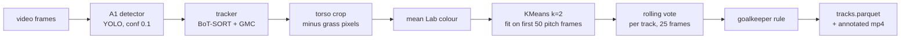

# football-team-tracker (A2)

Persistent player IDs and team labels from football broadcast video. Every tracker is measured with
HOTA / DetA / AssA / IDF1 on SoccerNet-Tracking twice: on ground-truth boxes (**oracle**, the tracker's
ceiling) and on the boxes of my own detector, A1 (**real**). The gap between the two is what the detector costs.

**Demo video:** [YouTube (unlisted)](https://youtu.be/7crGFAqdM8E). A broadcast highlights clip run through
`scripts/process_video.py`, ids and team colours drawn on. Footage © its rights holder, shown as a non-commercial
portfolio demo. No SoccerNet footage is published anywhere in this repo.

## Results (SoccerNet-Tracking test split, 49 clips, run once)

Settings were chosen on the 11 validation clips only; the test split was run once at the end with them fixed.

| Tracker | Oracle HOTA | Real HOTA | Real DetA | Real AssA | Real IDF1 | Detector cost |
|---|---|---|---|---|---|---|
| **BoT-SORT + GMC** | **84.2** | **59.0** | **70.9** | **49.4** | **68.5** | 25.2 |
| BoT-SORT (no GMC) | 80.4 | 56.6 | 69.9 | 46.0 | 65.2 | 23.9 |
| Deep OC-SORT + GMC | 76.6 | 56.0 | 69.0 | 45.6 | 65.4 | 20.6 |
| OC-SORT (+ BYTE low-conf pass) | 75.2 | 55.4 | 68.0 | 45.3 | 65.5 | 19.8 |
| ByteTrack | 74.1 | 55.3 | 68.1 | 45.1 | 65.2 | 18.8 |
| OC-SORT | 75.2 | 55.2 | 68.1 | 44.9 | 65.2 | 20.1 |
| FastTracker | 74.1 | 55.0 | 68.2 | 44.5 | 64.4 | 19.2 |

- **The detector costs about 19-25 HOTA points**, e.g. BoT-SORT+GMC 84.2 -> 59.0 and ByteTrack 74.1 -> 55.3.
  The split is approximate, not additive: a missed box hurts differently depending on the tracker's settings.
- **Association suffers more than detection.** Real AssA falls to 45-49 while DetA stays near 68-71.
- **Camera-motion compensation (GMC) matters for broadcast video.** It is BoT-SORT+GMC's edge: on oracle boxes it cuts
  ID switches from 3524 to 1251.
- **The bottom five trackers are within 0.4 HOTA** and swap places between val and test, so treat them as equal.
- Tuning (one shared setting for all trackers: `track_high_thresh 0.25`, `match_thresh 0.9`) gained +1.1..+3.5 HOTA on
  val and +0.3..+2.7 on test.

### Team assignment

| What is scored | Val (11 clips) | Test (49 clips) |
|---|---|---|
| Ground-truth boxes, per detection / per player | 96.9% / 100% | 96.6% / 99.6% |
| Detector boxes (matched to GT players), per detection / per player | 98.6% / 100% | 98.1% / 99.6% |
| Tracked + vote, per detection | 98.2% | 97.8% |
| Label flips: raw -> vote | 870 -> 161 | 4818 -> 1010 (-79%) |
| Goalkeepers: right / wrong / unknown | 8 / 1 / 7 of 16 | 21 / 5 / 37 of 63 |

The detector rows only score players the detector found, so they are not "better than GT". Cluster ids are arbitrary,
so accuracy uses the better of the two cluster-to-side mappings.

### Out-of-domain check: SportsMOT

The same one-command pipeline (`process_video.py`, settings unchanged) on 2 football clips from
[SportsMOT](https://github.com/MCG-NJU/SportsMOT)'s val split: a different broadcaster and stadium, 720p instead of 1080p,
53 s in total. Scored against SportsMOT's player boxes (players and goalkeepers kept).

| Clip | HOTA | DetA | AssA | IDF1 | IDSW |
|---|---|---|---|---|---|
| v_ITo3sCnpw_k_c010 (22 s) | 67.3 | 74.0 | 61.4 | 78.8 | 28 |
| v_ITo3sCnpw_k_c011 (31 s, fast pan + blur) | 46.9 | 55.9 | 40.2 | 51.1 | 145 |
| **Both** | **56.1** | **63.1** | **50.3** | **63.1** | 173 |

- **Tracking transfers about as well as on SoccerNet** (BoT-SORT+GMC real HOTA 59.0 on SoccerNet test), with only 2 clips,
  so this is a sanity check, not a benchmark. The two datasets also draw boxes slightly differently.
- **Team colours:** SportsMOT has no team labels, so this is checked by eye only. Most players are coloured correctly, but
  **the referee in black is detected as a player and joins a team**, and a few red shirts flip on the 22 s clip.
- No SportsMOT frames are published here (its terms forbid redistribution without permission).

## How it works



1. **Detect.** A1's YOLO (v3, yolo26n) finds players, goalkeepers and referees. Confidence is kept low (0.1) so the
   tracker's second pass can use weak boxes.
2. **Track.** Ultralytics' tracker classes give each box an id. Evaluation feeds cached boxes to the tracker; uploaded
   video goes through `model.track(stream=True)`, and both give identical output on a val clip.
3. **Colour.** For each player box: take the torso band (15-50% of the height, 20% trimmed off each side), drop grass
   pixels (HSV hue 34-42), and take the mean colour in Lab space, where distances match how different colours look.
4. **Cluster.** KMeans with k=2 on the players of the first 50 frames that show at least 3 players. No labels needed.
5. **Vote.** Each track's label is the majority of its last 25 frames. There is no permanent lock: trackers sometimes move
   an id onto another player, and a lock would keep the wrong team for the rest of the clip (lock cost 6-8 accuracy points).
6. **Goalkeepers.** A keeper's colour matches neither team, so a keeper joins the team whose players stand nearer in the
   image (median x). If the teams overlap or the keeper is in between, the answer is "unknown" (null), not a guess.
7. **Export.** `tracks.parquet` in A2's schema (frame, track id, box, role, team; pitch coordinates and jersey numbers
   are null, not zero, until later projects fill them), plus an annotated mp4.

## Run it

```bash
uv sync --extra dev
uv run ruff check .
uv run pytest -m "not integration"            # no data needed; data-dependent tests skip

# Any football video (needs A1's weights at the path in configs/paths.yaml)
uv run python scripts/process_video.py path/to/clip.mp4
#   -> reports/<detector>/process_video/<clip>/tracks.parquet + annotated.mp4

# SoccerNet evaluation (needs SoccerNet-Tracking locally, see configs/paths.yaml)
uv run python scripts/cache_detections.py --split val
uv run python scripts/run_ablation.py --source real --split val
uv run python scripts/eval_team_vote.py --split val
```

Layout: `src/ftt/` (data, detect, track, team, eval, schema, export, render, video), `scripts/` (one command per
experiment), `configs/` (tracker YAMLs, `team.yaml`), `tests/`.

## Limitations

- **Two colours only.** Teams in similar colours, or striped kits (mean colour smears), are not handled and not measured.
- **Ids restart at every camera cut.** There is no re-identification across shots.
- **Goalkeepers use image position**, so camera pans, counter-attacks and set pieces can fool the rule. It abstains on
  about half the keepers.
- **Close-ups on uploaded video.** Team colours are only trusted on wide pitch views (at least 3 players, median box
  height <= 20% of the frame). Medium shots can slip through, because the rule uses the per-frame median.
- **Detector errors pass through:** a keeper or referee in a dark kit detected as "player" joins a team (seen on the
  demo and on SportsMOT); a club crest in a logo card was detected as a player.
- **Goalkeeper thresholds are in pixels of a 1920-wide frame**, so they are stricter than intended on 720p video.
- **Failure case seen in the demo:** in a medium shot at 38 s, a red-shirted player is drawn in the other team's colour,
  because the frame passes the pitch-view check while the colours learned on distant views do not fit.
- **The schema contract with B1 is deferred** until A3 supplies pitch coordinates (B1 requires them non-null).
- **Rendering uses plain OpenCV**, not `supervision`, so the drawing code has no extra dependency.

## Data and attribution

- **SoccerNet-Tracking** (Cioppa et al., "SoccerNet-Tracking: Multiple Object Tracking Dataset and Benchmark in Soccer
  Videos", CVPR Workshops 2022). Used under SoccerNet's terms for non-commercial research. No frames, clips or labels
  are redistributed here; only derived numbers are reported.
- **Detector:** A1 (football-detect-serve, sibling project). Weights are referenced by path, not copied.
- **Trackers:** [Ultralytics](https://github.com/ultralytics/ultralytics) (AGPL-3.0). Metrics:
  [TrackEval](https://github.com/JonathonLuiten/TrackEval).

## License

AGPL-3.0, see [LICENSE](LICENSE). The repo uses Ultralytics' trackers, which are AGPL-3.0.
